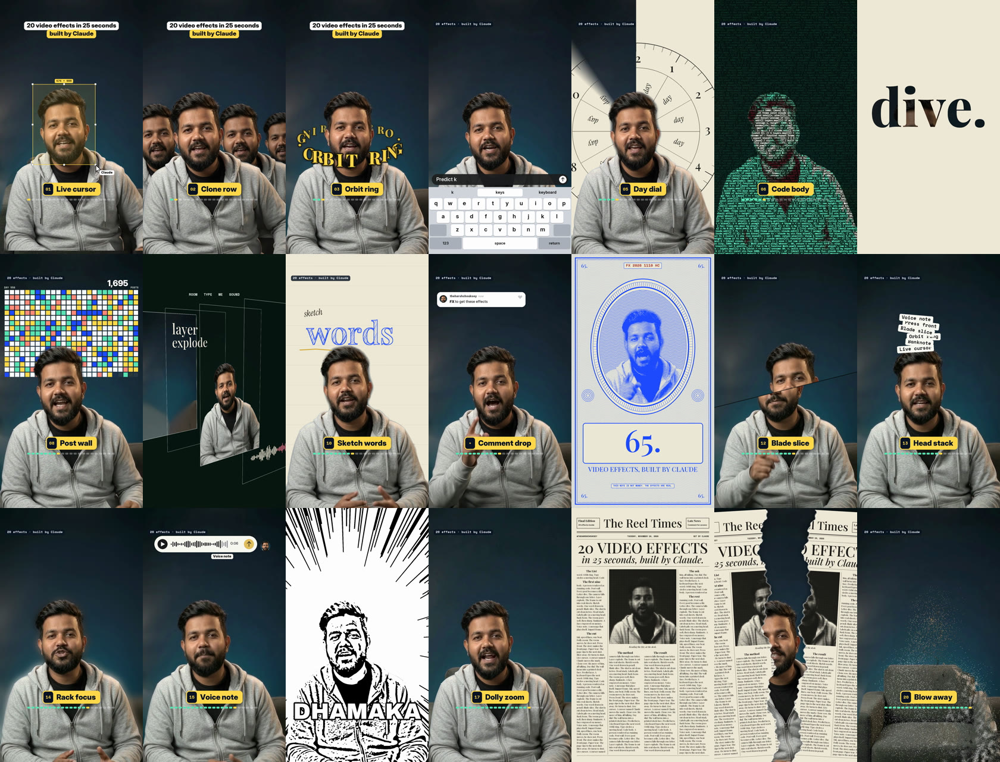

# 65 Video Effects for Claude

Drop your talking video into Claude, type `/effects` and the name of an effect. Claude writes the edit and gives you the finished file. No editing app.



Made for creators by [@theharshchouksey](https://instagram.com/theharshchouksey).

## Install (one line)

Open Claude Code (the desktop app or the terminal) and paste this in the chat:

```
Install the skill from github.com/harsh0332/claude-65-video-effects into ~/.claude/skills/effects
```

Claude does it for you. Or do it yourself in a terminal:

```bash
git clone https://github.com/harsh0332/claude-65-video-effects ~/.claude/skills/effects
```

On Windows (PowerShell), use `$HOME\.claude\skills\effects` instead of `~/.claude/skills/effects`. Then restart Claude Code.

## Use it

1. Open Claude Code.
2. Drag your video into the chat.
3. Type the effect you want:

```
/effects orbit-ring from 3 to 5 seconds, text "ORBIT RING"
/effects banknote when I say "money", number 65000
/effects comment-drop at the end, word FX
/effects impact-frame on the word "boom"
```

The first time, Claude sets itself up (about 2 minutes). It needs `ffmpeg` and Python and installs them if they are missing.

Claude checks a few frames first, moves anything that covers your face, then renders `yourvideo_effects.mp4` next to your original. Your audio stays as it was.

You can stack effects in one go: *"Add live-cursor for the first second, then clone-row, then orbit-ring."*

### Make a "20 effects in 25 seconds" reel

Record yourself naming the effects, about one per second. Then tell Claude:

```
/effects For every effect name I say, play that effect until I say the next one. Add the nameplate card at the bottom.
```

## The 65 effects

### New: 20 effects

| # | Type this | What happens |
|---|---|---|
| 46 | `live-cursor` | A cursor named Claude selects you with a box, then drags you left and right like a layer |
| 47 | `clone-row` | Copies of you line up behind both shoulders |
| 48 | `day-dial` | The wall wipes into paper with a big clock dial behind your head |
| 49 | `predict-keys` | A phone keyboard slides up and types your words |
| 50 | `orbit-ring` | Your words circle your head as a ring, passing behind you |
| 51 | `code-body` | You become running code |
| 52 | `post-wall` | A wall of tiny tiles fills in behind you while a counter runs up |
| 53 | `letter-dive` | A word types on paper with the video inside the letters, then the camera dives through one letter |
| 54 | `layer-explode` | The shot pulls apart into glass sheets in 3D |
| 55 | `sketch-words` | The wall becomes paper and one word is sketched in pencil above your head |
| 56 | `blade-slice` | A diagonal cut: the top half slides off and snaps back |
| 57 | `head-stack` | Label chips drop and pile up on your head |
| 58 | `rack-focus` | Focus goes to the room, then back to you |
| 59 | `banknote` | A banknote with your face engraved on it and a number counting up |
| 60 | `voice-note` | A voice-note bubble records, plays and shows Delivered |
| 61 | `impact-frame` | A manga impact frame: ink, speed lines, one big word |
| 62 | `dolly-zoom` | The room pushes in while you stay the same size |
| 63 | `press-front` | A newspaper front page with your headline and a halftone photo of you |
| 64 | `paper-tear` | The newspaper rips down the middle to reveal the shot |
| 65 | `blow-away` | You turn to dust and blow away, leaving the empty room |

Bonus: `comment-drop` (big letters drop into a comment bar and the comment posts), `nameplate` (a numbered "now playing" card at the bottom), `tracklist` (an "in this video" list on the right) and `caption-pills` (caption lines in pills).

### The first 45

| # | Type this | What happens |
|---|---|---|
| 1 | `noise` | Reels pile up behind your head |
| 2 | `lineup` | Numbered tiles fan out above your head |
| 3 | `locked-on` | Brackets lock onto your face and the camera follows you |
| 4 | `orbit` | Your reels circle your head, behind you at the top |
| 5 | `lean-in` | A quick punch-in on one word |
| 6 | `backdrop-word` | A giant word drops in behind you |
| 7 | `spotlight` | Kill the lights, keep you lit |
| 8 | `the-bill` | Your instructions print out like a receipt |
| 9 | `moody` | A moody colour grade |
| 10 | `swipe` | A before and after slider |
| 11 | `todo` | A checklist beside your head that ticks off as you talk |
| 12 | `comment-box` | An Instagram comment types itself and posts |
| 13 | `tap` | A Follow button flips to Following |
| 14 | `pause-point` | Freeze frame with a hand-drawn arrow |
| 15 | `uninstall` | A glitchy uninstall bar breaks the frame |
| 16 | `reel-frame` | Your video shrinks into a reel card |
| 17 | `shortcut-rain` | Keyboard keys rain down behind you |
| 18 | `reject-stamp` | A big red stamp slams down |
| 19 | `countdown-flip` | A 3, 2, 1 flip clock above your head |
| 20 | `rabbit-hole` | The room tunnels away behind you |
| 21 | `cover-star` | You become a magazine cover |
| 22 | `scribble` | Marker doodles draw themselves around you |
| 23 | `glass-widgets` | Frosted glass widgets float around your head |
| 24 | `red-collage` | Black and white you, a giant red word behind, three lines slam in |
| 25 | `split-headline` | A headline card slides down and pushes you to the bottom half |
| 26 | `pastel-word` | Lavender room, a giant word behind you, a profile card gets followed |
| 27 | `check-pills` | Grid-paper room, your reels pinned behind you, blue pills get clicked |
| 28 | `timeline` | A dark red film look with an editing timeline and a glowing playhead |
| 29 | `headline-box` | A punch-in with a clean two-line headline |
| 30 | `profile-wall` | Your reels grid fills the wall while a counter ticks up |
| 31 | `tier-list` | A tier list drops in and Claude flies into S tier |
| 32 | `broll-split` | B-roll on top with a price-tag sticker, you below |
| 33 | `phone-fan` | Your reels fan out like a hand of phones |
| 34 | `dot-reveal` | Your shot builds out of glowing dots, then snaps into focus |
| 35 | `headline-wall` | Your headlines pile up behind your head, then a total pops in front |
| 36 | `checklist` | A Claude task list under your chin, each step ticks green |
| 37 | `liquid-glass-graph` | A liquid glass card with a graph that climbs and a number that counts up |
| 38 | `carousel-spin` | Your reels spin around you in a 3D carousel |
| 39 | `match-cut` | News pages cut on one word, locked in place behind your head |
| 40 | `apple-toggles` | iPhone switches flip on, one line at a time |
| 41 | `led-sign` | The lights drop and a glowing LED sign types itself out behind you |
| 42 | `slow-push` | A slow cinematic push-in while the room melts out of focus |
| 43 | `over-the-shoulder-zoom` | Pushes into one corner, a glass graph pops beside your head, then the other corner |
| 44 | `messages` | Message notifications pop in one after another |
| 45 | `place-in-grid` | You shrink into the centre of your 3x3 profile grid, your reels pop in around you |

Every effect follows your face. Anything that would cover your face goes behind your head instead.

## Tips

- A vertical phone video with you in frame works best. Keep the camera on a stand and leave some empty wall above your head.
- Wear something that stands out from the wall. The cut-out around you is cleaner.
- Say the timing in plain words ("when I say 'watch'"). Claude finds the exact second.
- Counters, headlines and names should use your real numbers and your handle. Tell Claude what they are.
- `blow-away` needs one photo of the same shot **without you** (the "plate"). Record 2 seconds of the empty frame before you sit down and give that clip to Claude. `dolly-zoom`, `layer-explode` and `live-cursor` look better with it too.
- It renders in 1080p. Ask for 4K if you want it (slower).

## Honest notes

- These are starter versions. A finished reel also needs sound effects, music and timing by hand.
- It drafts, you approve. Watch the result before you post.
- No sounds or captions are added. Add those in your editor or ask Claude.

## If something goes wrong

Tell Claude what you see ("the word covers my face", "it is too fast"). It fixes the plan and renders again.

## Licence

MIT. See [LICENSE](LICENSE). The fonts in `fonts/` and the models in `models/` keep their own licences (`fonts/*.txt`, `models/NOTICE.md`).
